# BERICHT – Lauf „Gemeinde-Plattform“

> **Entwurf vom 14.10.2026.** Er wird nach der Schlussprüfung (Stufe C) mit Galerie und Stand der Kriterien Z-01…Z-21
> abgeschlossen.

## Ergebnis in drei Sätzen

1. Die Website der IGMG Wetzlar ist jetzt ein digitales Gemeindehaus:
   - den ganzen Quran lesen, mit Wortkarte und Tajwid-Leiste;
   - alle 7580 Hadithe aus Sahih al-Bukhari im arabischen Wortlaut;
   - das Elifbe mit Schreibweg lernen;
   - Gebetszeiten für Wetzlar und für den eigenen Ort.
2. Dahinter steht eine Plattform für Lehrkräfte, Eltern, Schülerinnen und Schüler, die schon fertig gebaut ist:
   - Gruppen, Anwesenheit, Fortschritt und Hifz;
   - ein moderierter Gruppen- und Elternkanal mit Kinderschutz;
   - Push-Mitteilungen auf Wunsch;
   - eine Verwaltung, in der Ehrenamtliche Seiten, Menüs, Anzeige-Folien und religiöse Freigaben selbst pflegen.
3. Was Personendaten betrifft, ist eingebaut, aber ausgeschaltet, bis Vorstand und Datenschutz zugestimmt haben. Die
   Schritte dafür stehen der Reihe nach in `web/docs/GO-LIVE.md`, Abschnitt G.

## Was du heute live siehst (igmg-wetzlar.vercel.app)

| Bereich | Adresse | Was es kann |
|---|---|---|
| Quran | `/quran`, `/quran/1` … `/quran/114`, `/quran/cuz/1` … `/30`, `/quran/tajwid` | Alle Suren im Tanzil-Text, Cüz-Ring, Tajwid-Farben mit Mustern (nicht nur Farbe), Wortkarte mit Häufigkeit, Tajwid-Seitenleiste, Lesemodi, Lesezeichen auf dem Gerät, Sure oder Cüz für unterwegs speichern (offline) |
| Hadith | `/hadith`, `/hadith/bukhari`, `/hadith/bukhari/1` … `/97`, `/hadith/auswahl` | Alle 97 Bücher von Sahih al-Bukhari mit arabischem Text, lange Bücher in Teilen zu 100, Suche nach Nummer und Wortlaut; Übersetzungen erscheinen erst nach Freigabe |
| Elifbe | `/lernen`, `/elifbe`, `/elifbe/buchstaben/be`, `/elifbe/ueben` | 29 Buchstaben mit Schreibweg, vier Formen, Lektionen, Übungen |
| Gebetszeiten | `/gebetszeiten`, `/gebetszeiten/anzeige` | Zeiten der Moschee wie bisher; „Mein Ort“ rechnet nur im Browser (GPS oder Ortsliste) mit Qibla-Nadel; Anzeige für den Bildschirm im Gebetsraum mit Iqama, Freitagsmodus und Folien |
| Kür | `/kalender`, `/ramadan`, `/spenden` | Islamischer Kalender mit iCal, Ramadan mit Imsakiye, Spenden per GiroCode (ohne Zahlungsdienst) |
| Moschee 2026 | `/`, `/ueber-uns`, `/projekte` | „Unsere neue Moschee ist eröffnet“, Zeitleiste bis zur Eröffnung, Projekt als fertiggestellt |
| Quellen | `/quellen`, `/barrierefreiheit` | Alle Datenquellen mit Lizenz, Erklärung zur Barrierefreiheit |

Ohne Datenbank (Beispielmodus) zeigt `/verwaltung` den Hinweis „Verwaltung noch nicht eingerichtet“. Konten, Lernplattform,
Chat, Push, Hatim und Newsletter antworten mit „Seite nicht gefunden“, bis sie eingeschaltet sind.

## Vorführpfad für den Vorstand (5 Minuten)

Die Stationen 1–4 gehen live. Für die Stationen 5–7 braucht es die Vorschau mit Beispieldaten, also lokal oder nach G1 auf
einer Vorschau mit Datenbank.

1. **Startseite:** Der Tagesbogen zeigt die sechs Gebetszeiten (im Ramadan der Fastenbogen) und „Unsere neue Moschee
   ist eröffnet“.
2. **Sure Al-Fatiha** (`/quran/1`): Ein Wort antippen öffnet die Wortkarte, eine Regel (z. B. Hamzat al-Wasl) die
   Tajwid-Leiste. Sobald der Imam aufgenommen hat (MN-03), leuchten Vers und Wort beim Abspielen mit.
3. **Elifbe** (`/elifbe/buchstaben/be`): „Be“ schreibt sich selbst. Danach kommen die vier Formen und die Fundstellen im
   Quran.
4. **Gebetszeiten** (`/gebetszeiten`): Unter „Mein Ort“ Gießen wählen; die Zeiten stehen neben Wetzlar, mit Qibla.
5. **Lehrkraft:** Unter „Mein Bereich › Unterricht › Heute“ ist die Anwesenheit mit großen Schaltern in 20 Sekunden
   erfasst, danach kommt der Fortschritt je Stufe.
6. **Eltern:** Das Kind öffnen; zu sehen sind Termin, Anwesenheit, Fortschritt, die Abmeldung für heute und der
   Elternkanal. Der Kinderchat hat einen Meldeknopf und Öffnungszeiten.
7. **Verwaltung:** Eine Seite mit Bausteinen anlegen. Danach eine Folie für die Anzeige mit Zeitplan anlegen und
   „Gemeinde im Blick“ zeigen (Zahlen ohne Personendaten).

**Vorführung lokal mit Beispieldaten:**
- Vorschau bauen: `SITE_MODE=vorschau node scripts/vercel-bau.mjs`.
- Beispielkonten anlegen: `scripts/beispielkonten.ts`, Passwort aus `BEISPIEL_PASSWORT`.
- Starten: `next start` mit `BAU_PGLITE=1`.
- Die Schritte stehen in `_gemeinde/PRUEFPUNKT.md`.

## Was nur Menschen tun können

Die Reihenfolge steht in `web/docs/GO-LIVE.md`, Abschnitt G, die Entscheidungen in `_gemeinde/MENSCHEN.md`.

| Schritt | Wer | Wozu |
|---|---|---|
| Datenbank (Neon, Frankfurt) und Geheimnisse in Vercel (G1, MN-00) | Technik | Verwaltung, CMS und Formulare werden nutzbar |
| Verwaltungskonten mit Zwei-Faktor; Imam und Hoca mit religiöser Freigabe, zwei Personen Kinderschutz (G2, MN-20/23/24) | Vorstand, Technik | Inhalte pflegen und freigeben |
| Übersetzungen, Wortbedeutungen, Tajwid-Texte prüfen (G3, MN-02/04/05/07) | Imam, Hoca | Mehr Inhalt öffentlich |
| Datenschutz v2, DSFA, Einwilligungen, Schutzkonzept (MN-10/11) | Vorstand, DSB | Konten, Lernplattform und Chat einschalten |
| Rezitation Fatiha und Cüz 30 aufnehmen, Vereinbarung (G6, MN-03) | Imam bzw. Hafız | Player mit Mitlesen |
| Lokaler Server (G5, MN-12) | Technik | Sicherung, Takt, Kiosk im Gebetsraum |
| Moschee-Fakten: Eröffnungsdatum, Fotos, Kapazität (MN-08) | Vorstand | Platzhalter ersetzen |

## Stand der Prüfungen (14.10.2026, `main` 4115a5e)

- Unit: 1438 Tests grün. Integration: 1680 Tests grün.
- Bau: Produktion wie ein frisch importiertes Vercel-Projekt (ohne `APP_URL`, ohne Datenbank) 1866 Seiten, Vorschau
  2207 Seiten; Abruf von 1311 verlinkten Adressen ohne Serverfehler.
- Prüfwerkzeuge: Sprachen vollständig (de/tr/en), Religion-Prüfung 0 Befunde, Wortlaut der Rechtstexte unverändert.
- Sicherheitsprüfung S1: alle Befunde behoben.
- Live (https://igmg-wetzlar.vercel.app): 61 Adressen 200, 24 erwartete 404, keine Serverfehler; Funktionen in Frankfurt.
- Vercel-Import: Jeder Vorschlag der Import-Maske (Root Directory leer oder `web`) deployt gleich
  (`web/docs/deploy/VERCEL.md` Abschnitt 0).
- Sichtabnahme Runde 2: 14 von 19 Ansichten mit mindestens 8 von 10 (Runde 1: 11). Die übrigen fünf (Hadith-Buch,
  Projekte, Gruppenchat, Seiten-Editor, Bestandseditor) sind mit drei gegengeprüften Befundpaketen überarbeitet
  (`_gemeinde/berichte/sichtabnahme-2.md`); die Nachbewertung steht aus.

## Galerie

Aufnahmen aus der Sichtabnahme (Vorschau mit Beispieldaten, 14.10.2026), Handy 390 px und Desktop 1440 px. Namen und
Gruppen sind erfundene Beispielkonten; Angaben in eckigen Klammern sind Platzhalter für die Gemeinde.

| | |
|---|---|
| 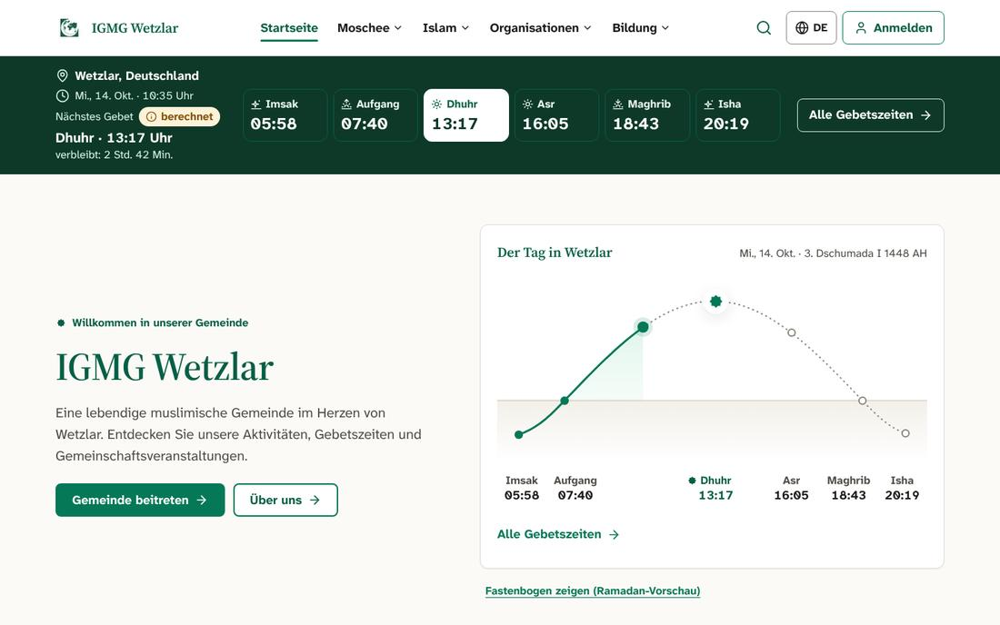 Startseite mit Tagesbogen | 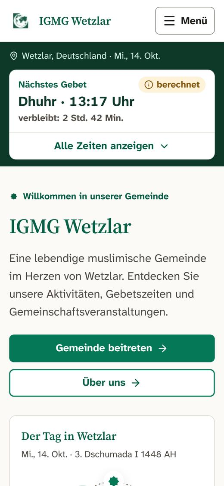 Startseite auf dem Handy |
| 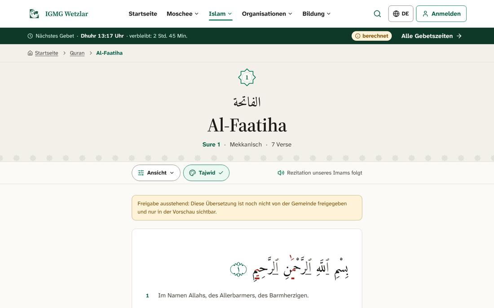 Sure Al-Fatiha mit Tajwid-Farben | 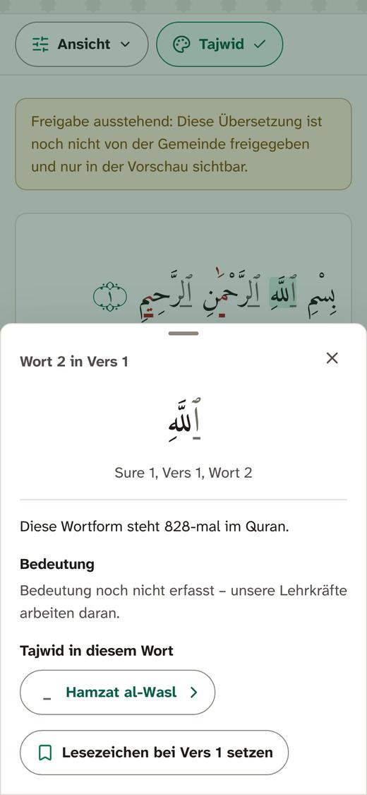 Wortkarte auf dem Handy |
| 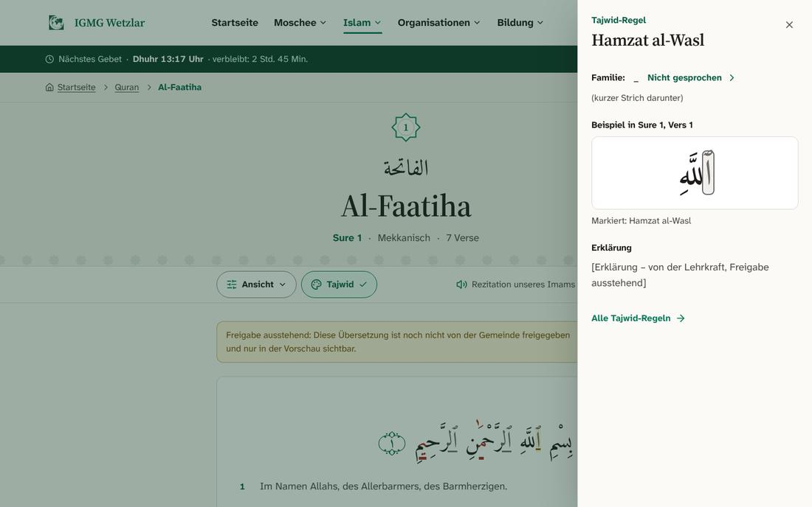 Tajwid-Regel in der Seitenleiste | 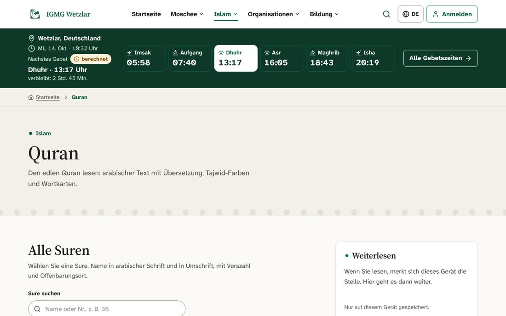 Koran-Übersicht mit Cüz-Ring |
| 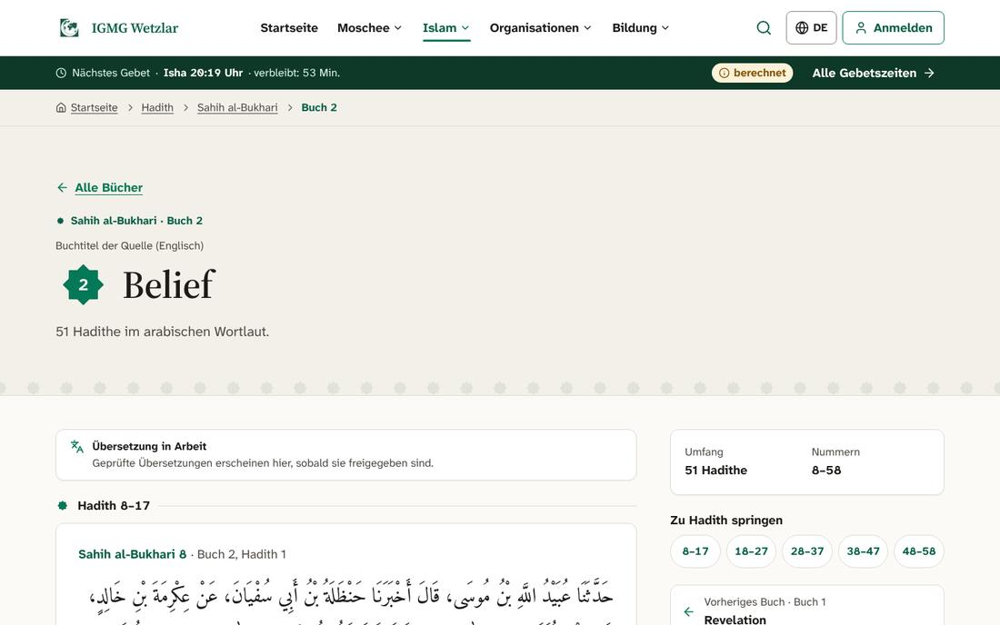 Sahih al-Bukhari, Buch 2 | 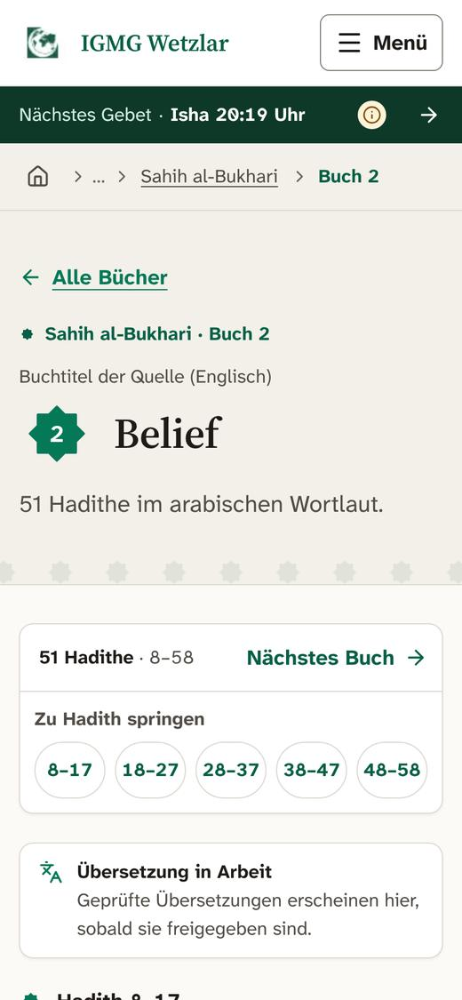 Sprungleiste auf dem Handy |
| 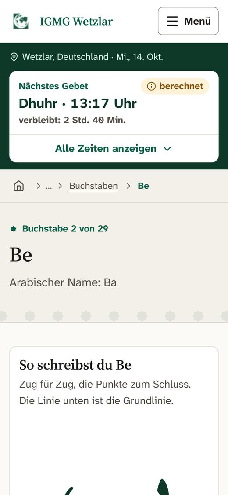 Elifbe: Buchstabe Be mit Schreibweg | 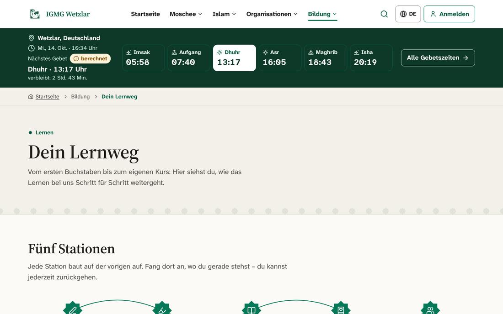 Lernweg von Elifbe bis Hifz |
| 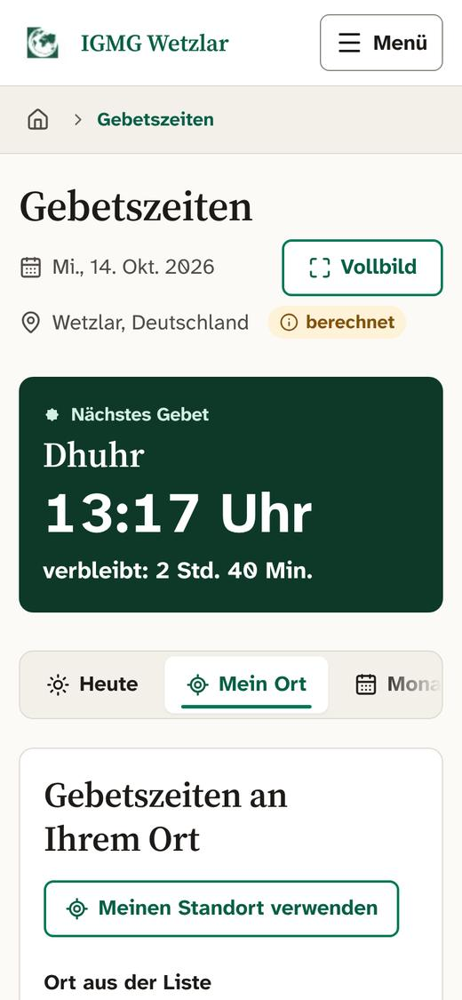 Gebetszeiten „Mein Ort“ mit Qibla | 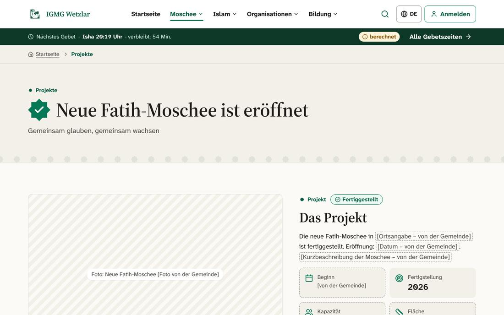 Die neue Moschee ist eröffnet |
| 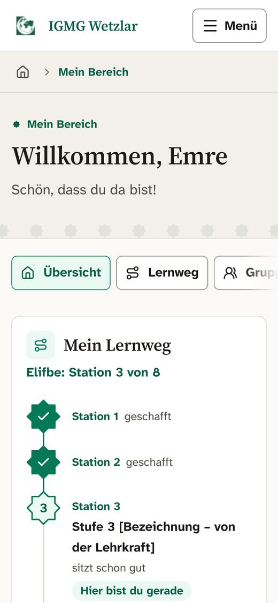 Mein Bereich eines Kindes | 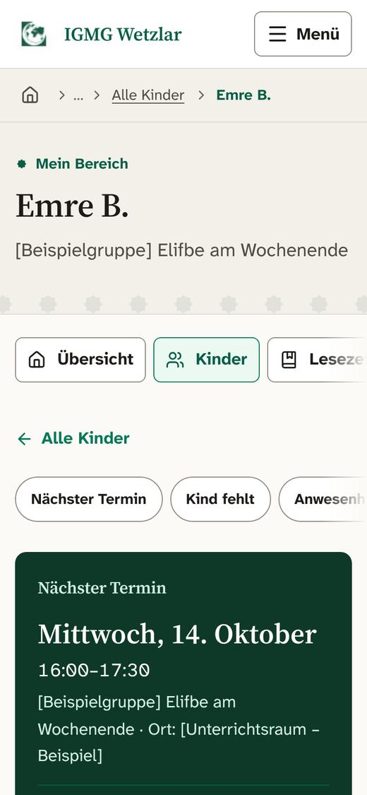 Eltern: Termin, Anwesenheit, Fortschritt |
| 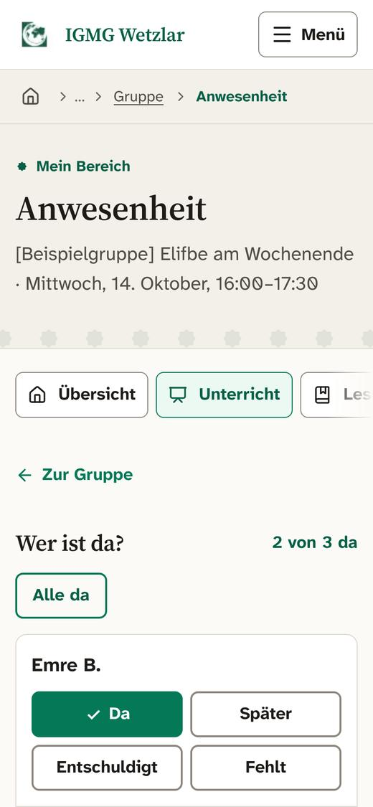 Lehrkraft: Anwesenheit in Sekunden | 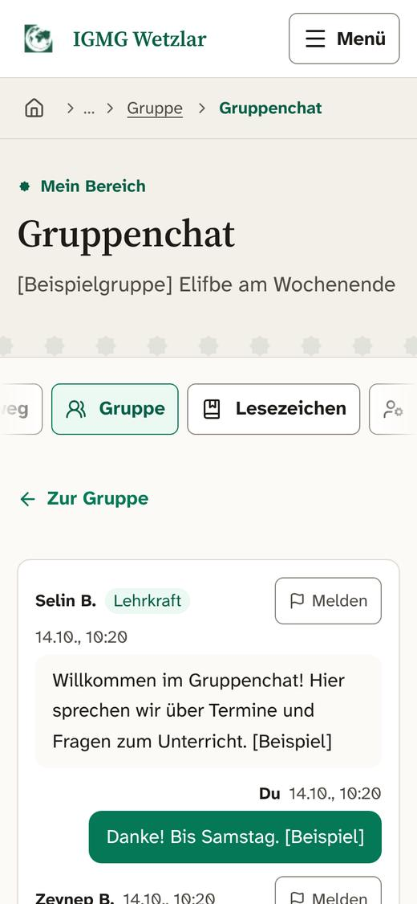 Moderierter Gruppenchat |
| 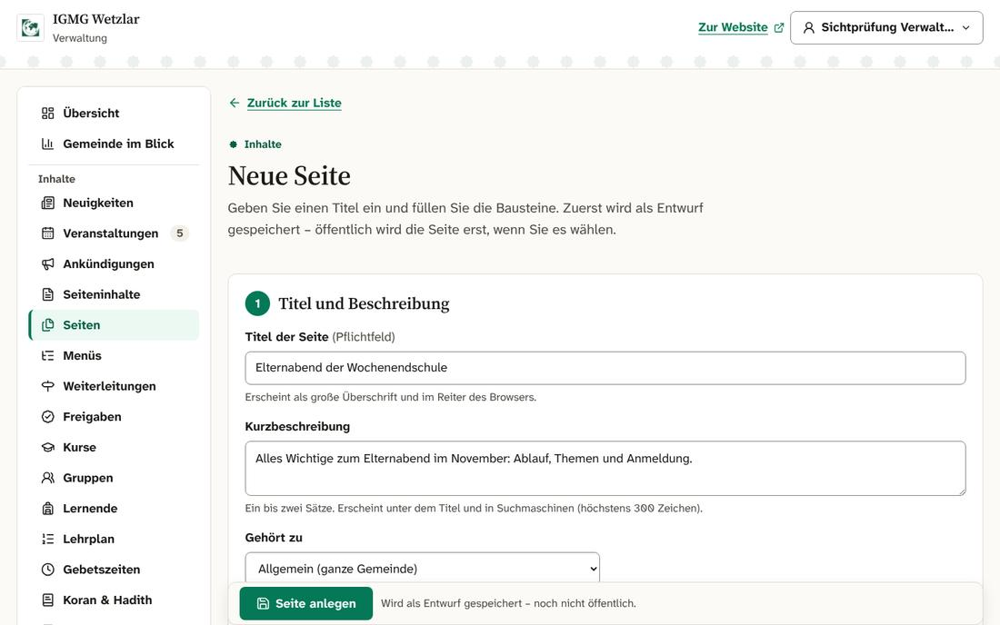 Verwaltung: Seiten mit Bausteinen | 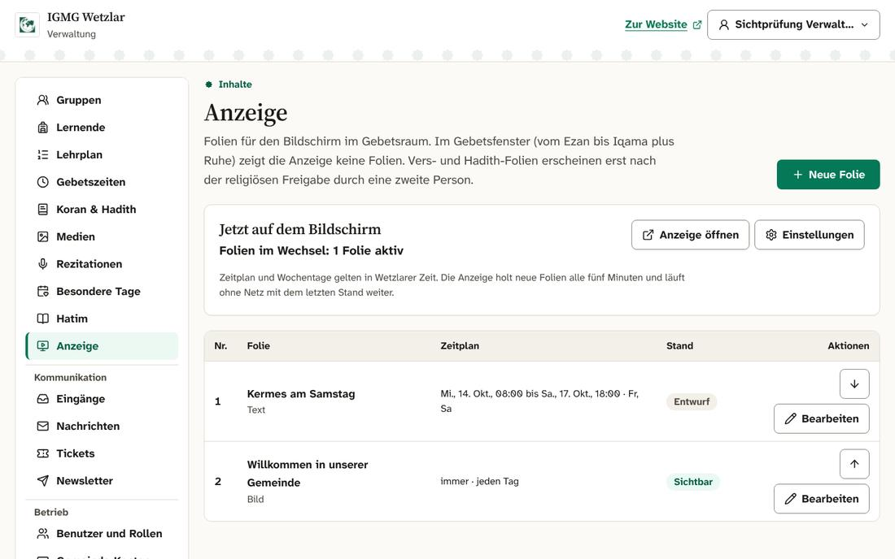 Verwaltung: Folien für die Anzeige |
