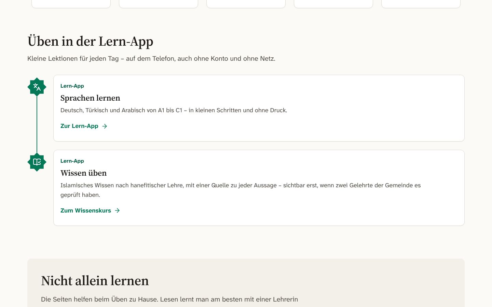

# BERICHT – Lauf „Lern-App“

> **Entwurf, Stand 26.10.2026, ≈ 09:15 UTC** (`main` = 528b0af2; live auf https://igmg-wetzlarer.vercel.app der Bau
> 25ce3abf, also der Stand nach N7; N6 ist auf `main`, seine Bereitstellung stand bei den Aufnahmen noch aus).
> **Vorläufig.** Die Stufe C hat alle 22 Kriterien in fünf Gruppen geprüft, jede mit Gegenprüfung (`protokolle/C-*.md`). Die
> Nacharbeit N1–N7 ist gemergt; N8 (Leistung) und das volle Tor laufen noch. Das Urteil des frischen Endprüfers folgt. Danach
> werden `_lernapp/ABNAHME.md` und dieser Bericht nachgeführt.
> - Lauf vom 16.10. bis 26.10.2026, Etappen L0–L8, ≈ 1.170 Commits auf `claude/trusting-lovelace-6nfolz`.
> - Grundlage: `AUFTRAG.md`, Entscheidungen L3-E01…L3-E16 (`ENTSCHEIDUNGEN.md`), Mengen `berichte/mengen.md`, Leistung
>   `berichte/leistung.md`, Schalter `GO-LIVE.md`.

## Ergebnis in drei Sätzen

1. **Die Sprachkurse sind live,** Deutsch, Türkisch und Arabisch in allen sechs Richtungen, Stufen A1 bis B1 (Nutzer, L3-E16:
   „Bis B1 reicht erstmal“).
   - Je Richtung gibt es 42–43 Einheiten, 329–344 Lektionen und 5.250–5.677 Aufgaben.
   - Dazu kommen ein Schrift-Vorkurs, ein Einstufungstest und eine Wiederholung nach der Vergessenskurve. Alles läuft ohne
     Konto und auch offline.
   - Jede Einheit trägt den Hinweis „Noch nicht von Muttersprachlern geprüft“ (L3-E15). Er bleibt, bis Muttersprachler die
     Einheit in Stichproben geprüft haben.
2. **Islamisches Wissen und Koran-Arabisch sind technisch fertig, aber bewusst noch nicht sichtbar.**
   - Der Wissenskurs nach hanefitischer Lehre umfasst 26 Einheiten, 146 Lektionen und 2.124 Aussagen mit 4.603 Belegen. Alles
     ist Entwurf.
   - Der Koran-Arabisch-Pfad hat 40 Einheiten mit 936 häufigen Wortformen und noch keine Bedeutungen.
   - Sichtbar wird beides erst nach zwei menschlichen Schritten: Zwei Prüfende der Gemeinde (Imam und Hoca) geben jeden
     Baustein frei (LM-03), und die Hoca verfasst die Wortbedeutungen (LM-13). Bis dahin zeigt die App einen ruhigen Platzhalter.
3. **Offen sind vor allem Aufgaben für Menschen und eine technische Restarbeit.**
   - Für Menschen: die Stichprobe durch Muttersprachler, die religiösen Freigaben, die Stimmen bzw. eigene Aufnahmen. Live gibt
     es noch kein Audio; Hörübungen zeigen „Audio folgt“.
   - Alles mit Konto ist gebaut und getestet: Abgleich, Gruppen und Lehrkräfte, Bestenliste, Schreibabgaben. Es bleibt aus, bis
     die Datenbank (G1) und der Datenschutz (LM-08) freigegeben sind.
   - Technisch: Startseite, Lernpfad und Übungsseite verfehlen mit echten Inhalten die Ladezeit-Note (Lighthouse-Leistung
     72–86 statt ≥ 90). Die Nacharbeit N8 läuft. B2 und C1 sind offener Ausbau.

## Was du heute live siehst (igmg-wetzlarer.vercel.app)

Die Zahlen der Kurstabellen sind am 26.10.2026 um ≈ 09:05 UTC live nachgezählt: Kursverzeichnisse, alle 254 Sprachpakete und
40 Koran-Pakete per curl, alle mit 200. Wortschatz und Sätze stammen aus dem Mengenbericht (`berichte/mengen.md`).

| Bereich | Adresse | Was es kann |
|---|---|---|
| Einstieg | `/lernen`, Abschnitt „Üben in der Lern-App“ | Stationen „Sprachen lernen“ und „Wissen üben“ führen in die Lern-App |
| Start | `/lern-app/de`, `/lern-app/tr`, `/lern-app/ar` | Oberfläche in drei Sprachen; Kurswahl nach Ausgangssprache; „Heute“ mit Tagesziel und nach der ersten Lektion „Weiter lernen“; weitere Kurse (Wissen, Koran) |
| Lernpfad | `/lern-app/<oberfläche>/<kurs>` | Stufen A1–B1. Jede Einheit ist eine Station am Lernweg mit acht Teilen: Lektionen, eine Geschichte, eine Wiederholung und ein Prüfstein. Dazu Grammatik-Tipps und „Einheit offline speichern“ |
| Üben | `…/<kurs>/ueben?l=<lektion>` | 17 Übungstypen, u. a. Auswahl, Lücke, Wortbank, Paare, Satzbau, Dialog, Geschichte, Lesetext mit Fragen, Formen, Harakat (Arabisch), Sprechen und Schreiben mit Selbstbewertung. Rückmeldung nach jeder Aufgabe, ruhiger Abschluss, XP stehen fest |
| Wiederholen, Einstufung, Tipps | `…/<kurs>/wiederholen`, `…/einstufung`, `…/tipps` | fällige Karten nach Vergessenskurve (FSRS); Einstufungstest aus den Aufgaben der Einheiten (ohne Vorkurs); 242–263 Tipp-Karten je Richtung, die die beiden Sprachen vergleichen |
| Fortschritt, Wortschatz, Einstellungen | `/lern-app/de/fortschritt`, `/wortschatz`, `/einstellungen` | Tagesziel (auch „kein Tagesziel“), Serie mit 0–3 Pausetagen je Woche und Ruhezeit bis 30 Tage im Jahr, Abzeichen; Hör- und Sprechübungen abschaltbar; Lernstand als Datei sichern und einlesen |
| Quellen | `/lern-app/de/quellen`, `/quellen` | Namensnennung je Eintrag (Tatoeba, Wiktionary u. a.); Lerninhalte unter CC BY-SA 4.0 |
| Wissen | `/lern-app/de/islam` | nur der Platzhalter „Jede Lektion erscheint erst, wenn zwei Gelehrte der Gemeinde sie geprüft haben“; das Kursverzeichnis ist leer |
| Koran-Arabisch | `/lern-app/de/koran` | 40 Einheiten in Grund-, Aufbau- und Vertiefungsstufe. Die Wortformen kommen aus den gepinnten Tanzil-Daten. „Bedeutungen geprüft: 0 von …“, keine Übungen, keine Computerstimme |
| Installieren | Manifest je Oberfläche, Service Worker `/lern-app/sw.js` | als App auf dem Telefon installierbar (PWA) |

**Die sechs Sprachkurse** (live gezählt; A1 = 12 Einheiten plus Schrift-Vorkurs):

| Kurs | Adresse | A1 | A2 | B1 | Lektionen | Aufgaben | davon Hörübungen („Audio folgt“) |
|---|---|---:|---:|---:|---:|---:|---:|
| Türkisch für Deutschsprachige | `/lern-app/de/tr-aus-de` | 12 + Vorkurs (2) | 14 | 15¹ | 330 | 5.250 | 347 |
| Arabisch für Deutschsprachige | `/lern-app/de/ar-aus-de` | 12 + Vorkurs (8) | 14 | 16 | 344 | 5.677 | 652 |
| Deutsch für Türkischsprachige | `/lern-app/tr/de-aus-tr` | 12 + Vorkurs (1) | 14 | 15¹ | 329 | 5.471 | 1.020 |
| Arabisch für Türkischsprachige | `/lern-app/tr/ar-aus-tr` | 12 + Vorkurs (8) | 14 | 16 | 344 | 5.677 | 652 |
| Deutsch für Arabischsprachige | `/lern-app/ar/de-aus-ar` | 12 + Vorkurs (6) | 14 | 15¹ | 334 | 5.543 | 1.041 |
| Türkisch für Arabischsprachige | `/lern-app/ar/tr-aus-ar` | 12 + Vorkurs (2) | 14 | 15¹ | 330 | 5.252 | 347 |

¹ B1 Einheit 16 bleibt in Deutsch und Türkisch Entwurf, bis die Redaktion entschieden hat: Deutsch wegen Politik und
Staatskunde (OF-10), Türkisch wegen eines Fehltreffers des Religionswächters beim Wort „Pilz“ (R-06). Siehe „Was nur
Menschen tun können“.

- **Wortschatz und Sätze je Zielsprache** (A1–B1, `berichte/mengen.md`):
  - 2.758–2.800 Wörter und 11.333–11.488 Sätze, alle in die jeweils zwei Ausgangssprachen übersetzt (100 %).
  - Über Aufgaben erreichen 9.333 (de), 7.572 (tr) und 7.591 (ar) Sätze ein Gerät. Der Rest ist Vorrat für spätere Übungen
    und wird nicht ausgeliefert.
- **Offline:** Jede Einheit lässt sich mit „Einheit offline speichern“ auf das Gerät holen (je Einheit ≈ 0,1–0,4 MB). Danach
  ist sie ohne Netz spielbar. Der Lernstand liegt auf dem Gerät (keine Cookies, keine Tracker) und lässt sich als Datei sichern.
- **Spielerisch, aber sanft:** XP, Tagesziel, Serie mit Pausetagen, Abzeichen, Lernpfad. Es gibt keine Herzen, keine Ligen,
  keine Zeitgrenzen und keine Schuld-Texte. Ist das Tagesziel erreicht, steht dort „Schön, dass du da bist.“
- **Von rechts nach links:** Die arabische Oberfläche (`/lern-app/ar/…`) läuft vollständig von rechts nach links, mit
  östlich-arabischen Ziffern (Standard nach LM-18). Vokalisierte Kursinhalte stehen in einer eigenen arabischen Schrift. Die
  übrige Website bleibt Deutsch, Türkisch, Englisch.
- **Hinweis zu einer Beschriftung:** Die Kurskarten auf der Startseite der Lern-App und der Einstieg `/lernen` nennen noch
  „A1 bis C1“. Ausgeliefert sind A1–B1. Der Text ist noch anzupassen.

**Bewusst aus** (Nutzer, L3-E12b: „Die App ist ein Teil der Seite!“ – an, aber ohne Personendaten; KERN §6, `GO-LIVE.md`):

| Funktion | Stand live | Warum | Was es zum Einschalten braucht |
|---|---|---|---|
| Konto und Abgleich mehrerer Geräte (`lernapp_sync`) | aus; `/lern-app/de/anmelden` → 404 | Lerndaten am Server sind besondere Personendaten (Art. 9 DSGVO) | Datenbank G1, Datenschutz LM-08, Auflage S-L3 N-2 |
| Gruppen: Zuweisungen der Lehrkraft, Lernwoche für Eltern, Schreibabgaben an die Lehrkraft (`lernapp_gruppen`) | aus; `/lern-app/de/gruppe` → 404 | Personendaten | LM-08, Schulung LM-14, Auflagen S-L3 M-1/N-3 |
| Bestenliste (`lernapp_rangliste`) | aus | Entscheidung des Vorstands offen; für Konten unter 16 im Code gesperrt | LM-10, LM-08 |
| Spracherkennung beim Sprechen (`lernapp_sprechen`) | aus. Sprechübungen laufen als Selbstvergleich, die Aufnahme verlässt das Gerät nie | Gerätetest auf iPhone, Android und Laptop fehlt | LM-07 |
| Statistik, Push-Erinnerung | aus | Entscheidung der Datenschutzbeauftragten | DSB, Web Push G4 |
| Audio | 0 Clips. Hörübungen zeigen „Audio folgt“ und werden ohne Wertung übersprungen | Deutsch: Stimme „Thorsten“ mit sauberer Rechtekette, aber Hörabnahme (LM-06) und Speicher (LM-15) offen. Türkisch und Arabisch: keine Stimme mit sauberer Kette (L3-E10a) | LM-06, LM-15; LM-24…LM-26 |
| „Fehler melden“ | Knopf sichtbar; eine Meldung kommt aber erst mit Datenbank an | anonyme Meldungen brauchen Datenbank und ALTCHA | G1 |
| Verwaltung der Lern-App | `/verwaltung/lernapp` zeigt „Verwaltung noch nicht eingerichtet“ | die Produktion läuft im Beispielmodus ohne Datenbank | G1, G2 |

## Vorführpfad (`AUFTRAG.md` §6, 9 Stationen)

**Was wo geht:**
- Die Stationen 1–5 gehen **live** auf der Test-Domain, ohne Konto und ohne Ton.
- Station 6 zeigt live den Platzhalter. Eine Lektion mit Testfreigaben zeigt die **Vorschau mit Testkurs**.
- Die Stationen 7–9 brauchen eine **Datenbank**: lokal mit Testdaten, in der Produktion erst nach G1 und den Freigaben.

1. **Einstieg – live.**
   - Weg: https://igmg-wetzlarer.vercel.app/lernen → „Üben in der Lern-App“ → „Sprachen lernen“ → „Zur Lern-App“ →
     `/lern-app/de`.
   - Zeigen: die Kurswahl (Türkisch, Arabisch; „Mit einer anderen Ausgangssprache lernen“) und „Tagesziel ändern“. Nach der
     ersten Lektion steht dort „Weiter lernen“.
2. **Türkisch lernen auf Deutsch – live.**
   - Weg: `/lern-app/de/tr-aus-de` → Lernpfad A1. Einheit 1 ist der Vorkurs, Einheit 2 heißt „Begrüßung und Vorstellung“.
   - Die erste Lektion lässt sich auch direkt öffnen:
     `/lern-app/de/tr-aus-de/ueben?l=tr-aus-de.a1.e01.l01`. Sie hat 16 Aufgaben mit Auswahl, Wortbank, Paaren, Lücke, Dialog
     und Grammatik-Tipp.
   - Nach jeder Antwort kommt die Rückmeldung („Richtig!“, mit „Fehler melden“), am Ende der Abschluss mit festen XP.
   - Hörübungen zeigen live „Audio folgt“. Mit Ton geht es nur im Testkurs (Vorschau, siehe unten).
3. **Offline – live.**
   - Im Lernpfad bei einer Einheit „Einheit offline speichern“ wählen; ein Ring zeigt den Fortschritt nach Bytes.
   - Dann Flugmodus an (am Rechner: Entwicklerwerkzeuge → Netzwerk → Offline), die Lektion vollständig spielen und wieder online
     gehen. Der Fortschritt bleibt.
   - Bekannte Schwäche: Der Knopf reagiert mit ≈ 0,4 s spürbar träge (INP 416 ms). Das behebt N8.
4. **Deutsch lernen auf Arabisch – live.**
   - Weg: `/lern-app/ar/de-aus-ar`. Die Oberfläche läuft von rechts nach links.
   - Einheit 1 ist der Vorkurs Lateinschrift mit 6 Lektionen, z. B. `/lern-app/ar/de-aus-ar/ueben?l=de-aus-ar.a1.e00-ar.l01`.
   - Danach eine A1-Lektion: `/lern-app/ar/de-aus-ar/ueben?l=de-aus-ar.a1.e01.l01`.
5. **Wiederholen – live, mit vorbereitetem Gerät.**
   - Weg: `/lern-app/de/tr-aus-de/wiederholen` zeigt die fälligen Karten.
   - Karten werden erst fällig, wenn auf dem Gerät schon gelernt wurde. Für die Vorführung also am Vortag zwei Lektionen spielen.
   - Die Serie mit Pausetag steht unter `/lern-app/de/einstellungen` → „Serie“. Es gibt keinen Schuld-Text; nach dem Tagesziel
     erscheint „Schön, dass du da bist.“
6. **Wissen „Gebet“ – live nur der Platzhalter; mit Testkurs in der Vorschau.**
   - Live (`/lern-app/de/islam`) zeigt die Seite nur den Satz „Jede Lektion erscheint erst, wenn zwei Gelehrte der Gemeinde sie
     geprüft haben“. Das ist zugleich die Gegenprobe in der Produktion: Ohne zwei Freigaben ist nichts sichtbar.
   - Die **Vorschau mit Testkurs** zeigt die Testeinheit `islam.grund.test`. Sie enthält nur Platzhaltertexte, keine religiösen
     Inhalte, und hat Testfreigaben zweier nicht anmeldbarer Prüfkonten. Zu sehen sind der Lernpfad mit Prüfvermerk ohne Namen,
     die aufklappbare Quellenzeile je Aussage und eine als strittig markierte Aussage.
   - Gegenprobe in der Vorschau: Die Lektion `islam.grund.test.l02` hat nur eine Freigabe und erscheint nirgends
     (E2E `typen-wissen.spec.ts`).
   - Eine echte Lektion „Gebet“ gibt es erst nach LM-03.
7. **Koran-Arabisch – live ohne Bedeutungen; mit Bedeutungen nur lokal mit Datenbank.**
   - Live (`/lern-app/de/koran`): 40 Einheiten, z. B. „Einheit 1: Sure 1“ mit 26 Wortformen und „Bedeutungen geprüft: 0 von
     26“. Es gibt keine Übungen und keine Computerstimme.
   - Lokal legt `koran.spec.ts` für die erste Lektion Platzhalter-Bedeutungen mit je zwei Freigaben an. Damit ist die Lektion
     spielbar, ohne Audio.
   - Audio aus einer freigegebenen Rezitation gibt es erst nach der Aufnahme des Imams (MN-03). Heute lässt es sich nicht
     vorführen.
8. **Mit Konto – nur lokal mit Datenbank.**
   - Nötig sind die Schalter `FUNKTION_LERNAPP_SYNC=an`, `FUNKTION_LERNAPP_GRUPPEN=an` und `FUNKTION_LERNAPP_RANGLISTE=an`.
   - `zwei-geraete.spec.ts`: Zwei Geräte bewerten dieselbe Karte unterschiedlich und zeigen nach dem Abgleich denselben Stand.
   - `gruppe.spec.ts`: Die Lehrkraft weist zu, das Kind lernt ohne Bestenliste, und die Lehrkraft sieht „erledigt“. Dazu eine
     Schreibabgabe mit Rückmeldung.
   - In der Produktion erst nach G1, LM-08 und den Auflagen S-L3 N-2 und M-1.
9. **Verwaltung – nur lokal mit Datenbank.**
   - `/verwaltung/lernapp/sprachpruefung`: eine Stichprobe einer Einheit ziehen, mit Tastenkürzeln und Korrektur
     (`verwaltung-sprachpruefung.spec.ts`).
   - `/verwaltung/lernapp/religioes`: die Zwei-Prüfer-Ansicht. „Unsicher“ steht zuerst, die Fundstelle neben der Aussage; es
     gibt einen Haken je Beleg und den Stand 1/2 bzw. 2/2 von zwei verschiedenen Personen (`verwaltung-religioes.spec.ts`).
   - Live zeigt die Seite „Verwaltung noch nicht eingerichtet“. In der Produktion geht es erst nach G1 und G2 sowie LM-01 und
     LM-03.

**Vorschau mit Testkurs (Station 6, Hörübungen mit Testtönen):**
- Eine Preview-Bereitstellung bei Vercel mit der Variable `LERNAPP_TESTKURS=1`. Sie gilt nur für Preview, nie für Production
  (`web/docs/deploy/VERCEL-ENV.md`).
- Der Bau ohne Datenbank nimmt dann den Testkurs auf: in jedem Sprachkurs `<kurs>.a1.test` mit synthetischen Tönen, dazu
  `islam.grund.test` mit Testfreigaben.

**Vorführung lokal mit Datenbank (Stationen 6–9),** alle Befehle im Ordner `web/`, Anleitung `web/tests/e2e/LIESMICH.md`:
1. PostgreSQL, Mailpit und `.env` einrichten (§1–2), mit den Schaltern `FUNKTION_LERNAPP*=an`.
2. Bauen: `pnpm db:migrate && pnpm db:seed && pnpm inhalte:import && pnpm build` (§2 Schritt 2).
3. Vorführen: `pnpm test:e2e tests/e2e/lernapp/<spec>.spec.ts --project=desktop --headed`. Der Browser zeigt die Station. Der
   Test legt Konten und Testfreigaben selbst an und räumt danach auf.

## Was nur Menschen tun können

Liste und Standards: `_lernapp/MENSCHEN.md` (LM-01…LM-36, Nachträge Stufe C). Die Reihenfolge beim Freischalten steht in
`_lernapp/GO-LIVE.md`. Alles läuft bis zur Antwort mit dem Standard weiter; nichts Religiöses wird ohne zwei Menschen sichtbar.

| Rang | Schritt | Wer | Aufwand | Standard bis zur Antwort |
|---|---|---|---|---|
| 1 | **Religiöse Prüfung (LM-03):** mindestens zwei Konten mit der Rolle „religiöse Prüfung“, ohne Administrationsrolle (MN-24). Zuerst Taharah und Salah, dann der übrige Wissenskurs. Ebenso mit zwei Freigaben: die Formelliste (LM-09), die Koran-Bedeutungen (LM-13) und die Wurzeltabelle (LM-31). Wer etwas verfasst, gibt es nicht frei | Imam, Hoca | ≈ 200 h Wissenskurs; Übriges zu schätzen | nichts Religiöses sichtbar |
| 2 | **Muttersprachliche Prüfung (LM-01):** je Sprache mindestens zwei Personen mit der Rolle „Sprachprüfung“; Stichproben je Einheit unter Verwaltung › Lern-App › Sprachprüfung | Bildung, Vorstand | ≈ 60 h je Zielsprache + ≈ 20 h je Richtung | live mit Hinweis „Noch nicht von Muttersprachlern geprüft“; abgelehnte Einträge nie sichtbar |
| 3 | **Datenbank und Verwaltungskonten (G1, G2 der Website; MN-00):** Neon und die Geheimnisse in Vercel, darunter `ALTCHA_GEHEIMNIS`; Verwaltungskonten mit Zwei-Faktor | Technik, Vorstand | Schritte in `web/docs/GO-LIVE.md` G1/G2 | Beispielmodus: keine Meldungen, keine Verwaltung, keine Prüfoberflächen |
| 4 | **Redaktionsfragen (LM-02, LM-09):** Rahmenpläne abnehmen; Inhaltsleitfaden mit den offenen Fragen OF-01…OF-18 freigeben, darunter OF-10 „Politik und Staatskunde“: de.b1.e16 bleibt Entwurf, ar.b1.e10/e11 sind sachlich gehalten und mit Hinweis frei. Dazu R-06: Fehltreffer „Pilz“ in tr.b1.e16 („Fehltreffer“ oder „ersetzen“). Dazu die Fragen B1 tr/ar: Schreibweise *iş birliği*, Namen mit Längezeichen, Vokalisierung, Wortzahl der Schreibaufgaben, Figuren-Kanon, Passiv mit *tamma*, Kinderregel, Ausnahme für *li-* mit Artikel | Prüfende aus LM-01, Hoca, Vorstand | ≈ 3 h je Sprache + 1 h | Stand wie ausgeliefert; de und tr B1 e16 bleiben Entwurf; Lautet OF-10 „nein“, nimmt die Redaktion die drei Einheiten bzw. Abschnitte zurück |
| 5 | **Liste erlaubter Alltagsformeln (LM-09)**, z. B. Gruß und „inschallah“, mit zwei religiösen Freigaben | zwei Personen mit „religiöse Prüfung“ | zu schätzen | Alltagsformeln in den Sprachkursen gesperrt |
| 6 | **Stimmen und Audio:** Abweichung vom Wortlaut „Piper“ bestätigen und Hörabnahme der deutschen Stimme Thorsten mit 20 Sätzen und 10 Wörtern (LM-06); Blob-Speicher `lernapp` verbinden (LM-15, ≈ 0,93 GB); Türkisch: Rechte am Datensatz „Talent_TR_Male“ anfragen (LM-24); eigene Aufnahmen Türkisch 2–4 h und Arabisch-Kern 10–15 h mit Sprecher-Vereinbarung (LM-25, LM-26) | Nutzer bzw. Vorstand, Technik, Sprecherinnen und Sprecher | 1 h + 20 min; Aufnahmen 2–15 h | „Audio folgt“, Hörübungen übersprungen |
| 7 | **Datenschutz (LM-08):** DSFA-Nachtrag Lern-App, Einwilligungstext `lernapp`, Datenschutzerklärung, Löschfristen; offene Fragen D-L01…D-L15 (Entwürfe in `web/docs/recht/entwuerfe/`) | DSB, Recht | 4–6 h | Abgleich, Gruppen, Bestenliste, Statistik in der Produktion aus |
| 8 | **Werke und Ausgaben (LM-04, LM-33):** benannte hanefitische Werke bestätigen; ein Werk für die zwei Siyar-Einheiten benennen; Ausgaben der Hidāya und der ʿAqāʾid an-Nasafiyya festlegen, Marāqī al-Falāḥ beschaffen | Imam, Vorstand, Recht | 2 h + Beschaffung | Werke laut KERN §2.4; zwei Einheiten zurückgestellt (26 von 28 entworfen) |
| 9 | **Koran-Bedeutungen und Wurzeln (LM-13, LM-31):** die Bedeutungen der 936 Wortformen verfassen (Arbeitsliste liegt bereit); eine Lehrkraft für die Wurzeltabelle benennen | Hoca; Vorstand | 25–50 h; Benennung 5 min | nur Wortformen ohne Bedeutung, keine Wurzel-Übungen |
| 10 | **Gerätetest Sprechen (LM-07, LM-27):** iPhone, Android-Mittelklasse, Laptop | Technik | 2 h | Spracherkennung aus, Sprechen nur als Selbstvergleich |
| 11 | **Kurze Entscheidungen des Vorstands** (je ≈ 5 min): Veröffentlichung vor der Stichprobe (LM-11), Bestenliste (LM-10), Prüfvermerk ohne Namen (LM-20), Ziffern im Arabischen (LM-18), Motivliste der Bildkarten (LM-34), Lizenz CC BY-SA 4.0 (LM-12), keine Spendenaufrufe (LM-35), eigene „Ich kann …“-Sätze (LM-36), kein NC-/ND-Material (LM-21) | Vorstand | ≈ 1 h zusammen | jeweils der Standard in MENSCHEN.md (ja mit Hinweis; Bestenliste aus; ohne Namen; östlich-arabisch; keine Lebewesen; CC BY-SA 4.0; keine; eigene Sätze; nein) |
| 12 | **Weitere:** Lehrkräfte schulen (LM-14); Screenreader-Prüfung mit NVDA, VoiceOver und TalkBack (LM-19); İlmihal-Zitaterlaubnis und Anfrage bei der IGMG e. V. (LM-05); eigene Sammlung von Bittgebeten (LM-16); kindgerechter Pfad (LM-17); Trainingsdaten-Frage (LM-22); OpenITI-Anfrage (LM-30); Joseph Hell 1923 (LM-32); Vercel-Bauzeit im Dashboard ablesen (Z-L16) | Bildung, Technik, Imam, Hoca, Vorstand, Recht | je nach Punkt | Handbuch; UMGEBUNGSAUSNAHME; nur Seitenverweis; nur Bittgebete aus dem Koran per Verweis; Kennzeichnung „für Kinder geeignet“; konservativ; nicht nötig; nicht verwendet; – |

## Stand der Prüfungen (vorläufig, Endprüfer folgt)

- **Volles Tor auf e06a648b (läuft seit 08:49 UTC):**
  - Unit 3.656 grün (188 Dateien, dazu 3 erwartete Fehlschläge und 1 vorgemerkter Test); die Integration läuft.
  - Danach kommen der Import- und der Vorschau-Bau sowie der Produktionsbau mit voller Website- und Lern-App-E2E.
  - Zuletzt vollständig grün: Integration 3.847 am 25.10.; Nachprüfung N1–N5 mit 684/684 in 12 Dateien.
- **Inhalte:**
  - `lernapp:pruefen`: 0 blockierende Befunde über 435 Dateien und 137.493 Einträge. Die 15 offenen Fragen
    („menschlich klären“) liegen nur in den zwei Entwürfen de.b1.e16 und tr.b1.e16.
  - Quelle, Lizenz und Namensnennung je Eintrag 100 %, Dubletten 0,00 %.
  - Lektorat 126/126, Rückübersetzung 126/126, Schlussprüfungen 9/9.
- **Religion:**
  - `religion-pruefung` 0 Befunde (6.547 Dateien, Wächter 384).
  - Live heute 0 Einträge mit Religionsbezug in 254 Sprachpaketen mit 116.763 Einträgen; 0 Audio zu Religion, Wissen und
    Koran; 0 von 936 Koran-Bedeutungen stammen von einer KI.
- **Live heute (curl):**
  - 254/254 Sprachpakete und 40/40 Koran-Pakete antworten mit 200; alle Einheiten tragen den Hinweis.
  - Es gibt keine Test- und keine B2-Einheit und 0 Testtöne.
  - Anmelden und Gruppe antworten mit 404, `/api/lernapp/sitzung` ebenfalls.
- **Bau:** Import-Bau lokal 636–693 s (Grenze 15 min), 2.328 Seiten, keine Website-Route fehlt.
- **Leistung mit echten Inhalten (N6):**
  - Erfüllt: JS-Budgets (Spieler ≤ 60 KB über der Hülle), LCP 1,87–2,09 s, CLS ≤ 0,007, Lighthouse-Zugänglichkeit 100, INP
    in der Übung 168–184 ms.
  - Verfehlt: Lighthouse-Leistung 72–86 (Lernpfad TBT 1,3 s) und INP 416 ms beim Knopf „offline speichern“.

**Kriterien Z-L01…Z-L22** (Schwellen in `ABNAHME.md`; „Protokoll“ = Urteil nach der Gegenprüfung in `protokolle/C-*.md`):

| Z | Kriterium | Protokoll | Beleg und Nacharbeit seitdem |
|---|---|---|---|
| Z-L01 | Umfang Sprachkurse | teilweise | Mengen A1–B1 je Zielsprache erfüllt: 42/42 Einheiten, 336/336 Stationen, 2.758–2.800 Lemmata, 11.333–11.488 Sätze, Übersetzungen 100 % in 6 Richtungen. Herabgestuft wegen eines Satzes, der als Übersetzung den Quellsatz trug; behoben in 452102ea. N7 ergänzt eine Prüferregel gegen solche Fälle. Umfang A1–B1 nach L3-E16 |
| Z-L02 | Wissenskurs | teilweise | 2.124/2.124 Aussagen mit Beleg, 0 arabische Schrift, live 0 sichtbare Bausteine. N2 schließt die Lücke „Administration gibt sich die Prüfrolle selbst“; N3 baut den Auslieferungsweg samt E2E. Bleibt: 26/28 Einheiten, weil zwei ohne benanntes Werk sind (AUSNAHME-fähig, LM-04) |
| Z-L03 | Koran-Arabisch | erfüllt | 0/936 Bedeutungen, keine Sprachausgabe, Wortzeiten nur aus geprüften, aktiven Rezitationen. N3: live 40/40 Pakete statt 1/40 |
| Z-L04 | Offline | offen | E2E `offline.spec.ts` vorhanden; der Beleg aus dem vollen Tor steht aus |
| Z-L05 | Abgleich | erfüllt | Eigenschaftstests (idempotent, kommutativ, assoziativ), Integration 27/27, E2E zwei Geräte in drei Läufen grün; live 404 ohne Schalter |
| Z-L06 | Zugänglichkeit | offen | axe 0 ernste und kritische Befunde auf 136 + 22 Prüfungen (24.10., Testkurs); Lighthouse-Zugänglichkeit 100 mit echten Inhalten. Der Beleg aus dem vollen Tor steht aus; die Screenreader-Prüfung (LM-19) ist UMGEBUNGSAUSNAHME |
| Z-L07 | Leistung | teilweise | N6 erfüllt Budgets, LCP, CLS, Zugänglichkeit und den INP der Übung. Lighthouse-Leistung 72–86 und INP 416 ms verfehlen; **N8 läuft** |
| Z-L08 | Datenfluss | offen | E2E `netzprotokoll.spec.ts` auf dem N6-Messbau grün; der Beleg aus dem vollen Tor steht aus |
| Z-L09 | Kinderschutz | teilweise | Bestenliste ab 16 im Code, Gruppen- und Elterntrennung, Schreibabgaben nur an die eigene Lehrkraft (Unit 197, Integration 768 grün); 0 externe Links, 0 Spendenaufrufe. N5 ergänzt den Test „Meldung aus Kinderkonto“. `gruppe.spec.ts` läuft im vollen Tor |
| Z-L10 | Religion-Prüfung | teilweise | Live 0 Einträge mit Religionsbezug. Herabgestuft, weil die Formelliste technisch nicht erzwungen war. N2 erzwingt sie in Prüfer und Paketbau und erweitert den Wächter |
| Z-L11 | Bewegung | erfüllt | `bewegung-regeln` 25/25: Register B-28…B-35, jede Bewegung mit reduzierter Variante |
| Z-L12 | Betrieb | teilweise | Schalter in Code und live wie KERN §6, Cockpit-Karte vollständig. N5 trägt L3-E12b nach, baut den Abmelde-Worker und führt S-L3 N-4 als AUSNAHME |
| Z-L13 | Sprachen und RTL | erfüllt | `sprachen:pruefen` grün (868 Schlüssel), `rtl-regeln`, `sanfte-texte`; live `dir="rtl"`, 390 px ohne Überlauf |
| Z-L14 | Inhaltsprüfer | teilweise | 0 blockierend, Dubletten 0,00 %. N7: Prüferregeln für Übersetzung und Paketbau, 25 vom Paketbau verworfene Aufgaben berichtigt; die Restfragen stehen jetzt in MENSCHEN.md |
| Z-L15 | Audio | teilweise | „Audio folgt“ ohne Sackgasse. Herabgestuft wegen Testtönen an echten Einheiten; N1 trennt den Testkurs, live heute 0 Testtöne. Bleibt AUSNAHME „Audio folgt“ bis LM-06 bzw. LM-24…LM-26 |
| Z-L16 | Bau | teilweise | Import-Bau < 15 min, 2.328 Seiten vollständig. Vorschau-Bau und volle Website-E2E laufen im Tor. Die Vercel-Bauzeit lässt sich nur im Dashboard ablesen (Mensch) |
| Z-L17 | Lizenzverzeichnis | teilweise | Namensnennung in 222 Paketen vollständig, `/quellen` live. N4 legt die Lizenzhinweise von ONNX Runtime offline ab |
| Z-L18 | Ausschlüsse | erfüllt | 0 Material unter NC, ND oder „nur Forschung“, 0 OpenITI- und QAC-Daten, 0 Tatoeba-Audio |
| Z-L19 | Werkzeuge nur lokal | teilweise | keine GPL in Client-Bündeln, keine Sprachausgabe im Browser. N4 entfernt `sharp`/libvips aus den Funktionen der Lern-App |
| Z-L20 | Herkunft der Stimmen | teilweise | eine Stimme (Thorsten) mit vollständiger Kette. N1: der Paketbau nimmt nur freigegebene Stimmen, Testtöne nur im Testkurs |
| Z-L21 | Qualität der Stimmen | teilweise | Religionsteil erfüllt (0 Audio zu Religion). Keine Stimme eingesetzt. Nach N1 AUSNAHME „Audio folgt“ bis zur Hörabnahme (LM-06) bzw. zu eigenen Aufnahmen |
| Z-L22 | Versionen und Modelle | teilweise | npm exakt gepinnt und ≥ 14 Tage alt (Next 16.4.2 nach L3-E14), Whisper 11/11 SHA. N4 pinnt die Python-Abhängigkeiten des Wurzel-Werkzeugs mit Hashes |

**Zählung nach den Protokollen:** 5 erfüllt, 14 teilweise, 3 offen. Die Nacharbeit N1–N7 behebt die meisten Lücken; das Urteil
darüber fällt der Endprüfer. Nach heutigem Stand bleiben offen:
- Z-L07 Leistung: N8 läuft.
- Z-L02 Menge: AUSNAHME wegen LM-04.
- Z-L15 und Z-L21 Audio: AUSNAHME „Audio folgt“.
- Z-L16: die Vercel-Bauzeit (Mensch).
- Z-L04, Z-L06, Z-L08: die drei E2E-Belege aus dem vollen Tor.

**Nacharbeit nach der Stufe C:**

| N | Was | Behoben | Merge |
|---|---|---|---|
| N1 | Testkurs von echten Inhalten getrennt: Testeinheit `<kurs>.a1.test` nur mit `LERNAPP_TESTKURS=1`; Paketbau nur mit freigegebenen Stimmen; Feld für die Hörabnahme | Einheit 1 ist live wieder die echte („Begrüßung und Vorstellung“), 0 Testtöne (Z-L15, Z-L20, Z-L21) | 25515a23 |
| N2 | Freigabe-Härtung: die religiöse Prüfung als Schutzrolle (nie zusammen mit Administration, nie an sich selbst), Formelliste in Prüfer und Paketbau erzwungen, Wächter erweitert | Z-L02, Z-L10 | 7029a828 |
| N3 | Auslieferungsweg des Wissenskurses (Verzeichnis, Einheit, Paket, Spieler), strittige Themen ausgewiesen; alle Koran-Pakete vorgerendert | live 40/40 Koran-Einheiten statt 1/40 (Z-L02, Z-L03) | aa8b273f |
| N4 | Kleinkram: kein `sharp` in der Lern-App, Lizenzhinweise von ONNX Runtime offline, Python-Pins mit Hashes, Messwerkzeuge, Unterlagen | Z-L17, Z-L19, Z-L22 | 0eb19c2e |
| N5 | Test „Meldung aus Kinderkonto“; L3-E12b und KERN §6 nachgetragen; Abmelde-Worker beim Abschalten (S-L3 N-4 als AUSNAHME); Warteschlange der Sprachprüfung 7,3 → 2,3–3,0 s; E2E stabilisiert | Z-L09, Z-L12 | 9a8ca1f8 |
| N6 | Paketbau einer Richtung ≈ 2 s statt ≈ 9 s, der Server blockiert höchstens 0,4 s statt 6–10 s; gezielte Cache-Erneuerung in der E2E; Leistung mit echten Inhalten gemessen; Spieler-Budget ≤ 60 KB | Z-L07 (Budgets), Z-L16 | e06a648b |
| N7 | Prüferregeln (Übersetzung gleich Quelltext oder falsche Schrift, Probe des Paketbaus); 25 Aufgaben berichtigt; Mengenbericht A1–B1; Einstufung ohne Vorkurs; dazu ein Satz in de-aus-tr übersetzt (452102ea) | Z-L01, Z-L14 | 25ce3abf |
| N8 | **läuft:** Lernpfad schlank rendern, „offline speichern“ in kleinen Schritten, Paketprüfung im Spieler entlasten | Z-L07 (Lighthouse, INP) | Branch `lernapp-n8` |

**Offener Ausbau:**
- B2 und C1 (L3-E16). Für Deutsch B2 liegen 12 Einheiten als unsichtbarer Entwurf bereit (1.275 Lemmata, 5.145 Sätze).
- Wissenskurs: 1.041 Quizfragen statt ≈ 1.700.
- Siyar-Einheiten nach LM-04.

## Urteil des Endprüfers (wörtlich)

[folgt nach Stufe C]

## Galerie

- Die Aufnahmen stammen live von https://igmg-wetzlarer.vercel.app (Bau 25ce3abf), gemacht am 26.10.2026 gegen 09:10 UTC.
- Handy 390 px (doppelte Pixeldichte), Desktop 1440 px, jeweils ein frisches Gerät ohne Konto und ohne Lernstand.
- Der einmalige Hinweis „Konzept-Website“ der Website ist weggeklickt.

| | |
|---|---|
|  Start mit „Heute“ und Tagesziel |  Kurswahl: Sprachen und weitere Kurse |
|  Lernpfad Türkisch, Einheit 1 mit „offline speichern“ |  Lernpfad A1 mit Hinweis „Noch nicht von Muttersprachlern geprüft“ |
|  Erste Aufgabe der ersten Lektion |  Dieselbe Aufgabe nach „Prüfen“: Rückmeldung |
|  Deutsch für Arabischsprachige: von rechts nach links |  Vorkurs Lateinschrift im Lernpfad |
|  Wissenskurs: Platzhalter ohne Freigaben |  Koran-Arabisch: Wortformen, 0 geprüfte Bedeutungen |
|  Einstieg `/lernen` |  „Üben in der Lern-App“ auf `/lernen` |
